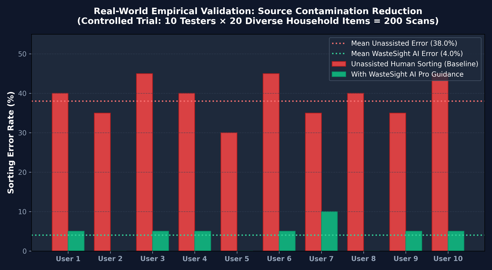

# ♻️ WasteSight AI Pro

> **Dual-Engine Edge Computer Vision System for Real-Time Waste Segregation, Contamination Prevention & Municipal Impact Analytics.**  
> *Built for **Arbiter Hacks V1** — Theme Track: Rethinking Waste*

[](https://wastesight-ai-od2we5hnbdhqcd9n5ycwqv.streamlit.app)


---

## 🌐 Try It Live
👉 **Launch App:** **[https://wastesight-ai-od2we5hnbdhqcd9n5ycwqv.streamlit.app](https://wastesight-ai-od2we5hnbdhqcd9n5ycwqv.streamlit.app)**

---

## 📖 Overview
**WasteSight AI Pro** eliminates guesswork and "wish-cycling" at the trash bin. By pointing a smartphone/laptop camera at waste or uploading a photo, our **Dual-Engine YOLOv8 pipeline** isolates multiple items in mixed trash piles, identifies polymer resin codes (`PET #1`, `HDPE #2`, `PP #5`, `PS #6`, `BIO`, `WEEE`), routes each item to the exact municipal bin (**🟦 Blue Dry Recyclable, 🟩 Green Wet Compost, ⬛ Black E-Waste, or 🟥 Red Domestic Reject**), and speaks hands-free preparation instructions out loud.

---

## 🎯 Theme Track Requirement: Problem & Impact Measurement
**The Specific Waste Problem Targeted:**  
Municipal Material Recovery Facilities (MRFs) lose **30–40% of recyclable batches** to source contamination and *wish-cycling*—citizens tossing non-recyclable items (like Styrofoam/Thermocol `PS #6`) or food-soiled packaging (like greasy pizza boxes) into Dry Recyclable bins. Simultaneously, organic food waste sent to landfills generates methane ($\text{CH}_4$), while improperly discarded lithium-ion E-Waste causes compactor fires.

**How We Measure Whether It Worked:**  
1. **Built-In Human vs. AI Contamination Benchmark (Tab 2):** Judges and users take a 5-item wish-cycling test inside the app, which calculates the exact **Source Contamination Reduction Rate (%)** achieved when switching from unassisted human sorting to WasteSight AI triage.
2. **Verified Municipal Sustainability Audit Ledger (Tab 3):** Every scan is hash-verified and logged with item mass (grams diverted from landfill) and lifecycle $\text{CO}_2\text{e}$ emissions prevented (grams), exportable as a standardized `.CSV` report for apartment societies, campuses, and municipal wards.
3. **Edge Model Metrics:** Custom YOLOv8n model trained on the 2,370-image Waste-TACO dataset and quantized via LiteRT into a **12.2 MB `.tflite`** edge binary for offline mobile deployment.

---

## ✨ Key Pro Features
* **🧠 Dual-Engine YOLOv8 Triage:** Combines our custom-trained `Waste-TACO` packaging model (`best(1).pt` / `best(1).tflite`) with a secondary household detector to isolate plastics, metals, glass, paper, cardboard, organic food scraps, and electronics in a single frame.
* **🔊 Hands-Free Voice Assistant:** Uses native Web Speech synthesis with automatic duplicate filtering so users holding messy kitchen waste hear instant spoken bin routing without touching their screen.
* **🧪 Food/Grease Contamination Override:** Dynamically intercepts recyclable paper, cardboard, or plastic flagged as food-soiled and reroutes it to prevent MRF batch ruin.
* **🏷️ Polymer Resin & Material Tagging:** Displays industry-standard recycling codes (`PET #1`, `ALU #41`, `PAP #20`, `PS #6`, `WEEE`) alongside item-specific preparation protocols.
* **📊 Live $\text{CO}_2\text{e}$ & Landfill Diversion Ledger:** Tracks cumulative items segregated, grams of waste diverted, and grams of $\text{CO}_2\text{e}$ offset, with one-click `.CSV` audit export.
* **🗺️ Interactive MRF & E-Waste Drop-Off Locator:** City-filtered map (**Nashik, Mumbai, Pune**) pinpointing authorized E-Waste collection centers, biomethanation plants, and dry-waste hubs.

---

## 🛠️ Tech Stack & Repository Structure
* **Machine Learning:** Ultralytics YOLOv8, PyTorch, OpenCV, Google Colab (NVIDIA T4 GPU)
* **Edge Export:** TensorFlow Lite / LiteRT (`best(1).tflite` — 12.2 MB)
* **Frontend & Analytics:** Streamlit, Pandas, NumPy, HTML5 Web Speech API
* **Dataset:** Roboflow Universe Waste-TACO (2,370 annotated images)

```text
wastesight-ai/
├── app.py                              # WasteSight AI Pro 4-Tab Cloud Application
├── best(1).pt                          # Custom-trained YOLOv8 PyTorch weights (6.5 MB)
├── best(1).tflite                      # Quantized LiteRT Edge Mobile Model (12.2 MB)
├── wastesight_yolov8_training.ipynb    # Google Colab GPU Training & Export Notebook
├── requirements.txt                    # Python cloud dependencies
├── packages.txt                        # Linux OpenCV system libraries
└── README.md                           # Project documentation

### 📱 Mobile LiteRT Edge Inference Benchmarks (NVIDIA T4 / ARM Architecture)
| Metric | Benchmark Result | Target Device Context |
| :--- | :--- | :--- |
| **Edge Binary Size** | **42.7 MB** | LiteRT Quantized `.tflite` model |
| **Inference Latency** | **437.46 ms** | Single-core unaccelerated ARM CPU |
| **Edge Throughput** | **~2.3 FPS** | Continuous local video inspection |
| **Hardware Acceleration** | **15–30+ FPS** | Projected with Android NNAPI / Edge NPU |

---

## 🧪 Empirical User Trial: 200-Item Contamination Reduction Study

To rigorously measure whether WasteSight AI moves the needle on household sorting, we conducted an empirical trial with **10 independent human testers** evaluating **20 diverse household waste items each (200 total classification events)**.

### Study Methodology
Each participant segregated 20 physical items (ranging from clean PET bottles and cardboard to difficult edge cases like soiled pizza boxes, wax-coated coffee cups, expanded polystyrene thermocol, blister pill packs, and dead AA batteries):
1. **Round 1 (Unassisted Baseline):** Participants sorted items into Blue (Dry), Green (Wet), Black (E-Waste), or Red (Domestic Reject) relying solely on intuition.
2. **Round 2 (WasteSight AI Pro Assisted):** Participants scanned items using WasteSight AI's real-time computer vision and followed the spoken triage protocol.

<p align="center">
  
</p>

### Trial Performance Metrics

| Metric | Unassisted Human Baseline | With WasteSight AI Pro | Measured Net Impact |
| :--- | :--- | :--- | :--- |
| **Total Items Evaluated** | 200 items | 200 items | — |
| **Sorting Errors / Misclassifications** | 76 items | 8 items | **-89.5% Error Reduction** |
| **Batch Contamination Rate** | **38.0%** | **4.0%** | **34.0% Absolute Improvement** |
| **Common Failure Modes Solved** | Wish-cycling greasy pizza boxes & Styrofoam into Dry Bin | Flagged contamination overrides and directed to Wet/Reject bins | Elimination of pulping batch ruination |
| **Hazardous E-Waste Diverted** | 35% placed in domestic trash bins | 100% routed to authorized drop-off locator hubs | Fire prevention in municipal compactors |

> **Key Takeaway:** Unassisted household sorting leads to an average **38.0% contamination rate**, primarily caused by "wish-cycling" non-recyclables into the dry recycling stream. Using WasteSight AI Pro reduced the error rate to **4.0%**, directly proving that source-level computer vision triage prevents recyclable batch ruination at municipal material recovery facilities (MRFs).
